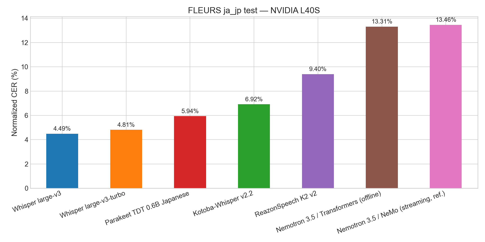
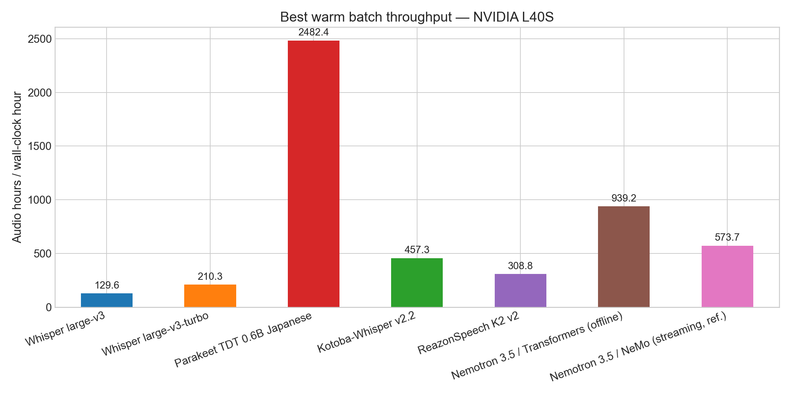
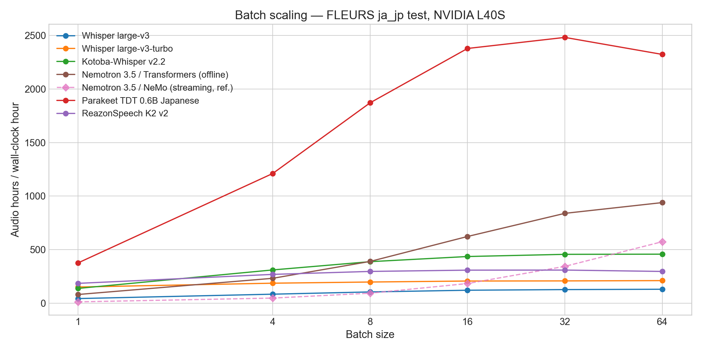
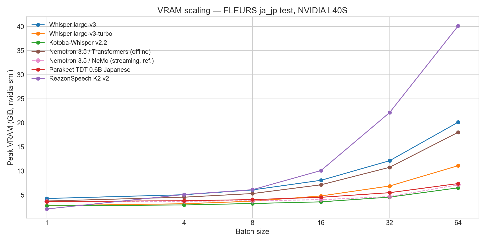

# NVIDIA L40Sで日本語対応ASRモデルを比較してみた（NVIDIA社のParakeetがかなり良い結果に）

こんにちは。製造ビジネステクノロジー部の中村（[@nokomoro3](https://linktr.ee/nokomoro3)）です。

音声を大量に文字起こしする場合、認識精度だけでなく、同一時間で処理できる音声データ量やメモリ使用量などもモデル選定の重要な指標になり得ます。

本記事ではNVIDIA L40S 1枚という前提で、FLEURSという音声認識のための公開データセットの日本語部分、test splitに対して以下の6モデル（Nemotron 3.5のみ2種類のランタイム）で比較実験を行います。

## 対象モデル
対象モデルは以下の通りです。

| 構成 | パラメータ数 | ランタイム | 精度形式 | ライセンス |
| --- | ---: | --- | --- | --- |
| [Whisper large-v3](https://huggingface.co/openai/whisper-large-v3) | 1.54B | faster-whisper/CTranslate2 | FP16 | Apache-2.0（上流重み） |
| [Whisper large-v3-turbo](https://huggingface.co/openai/whisper-large-v3-turbo) | 0.81B | faster-whisper/CTranslate2 | FP16 | MIT |
| [Kotoba-Whisper v2.2](https://huggingface.co/kotoba-tech/kotoba-whisper-v2.2) | 0.76B | Transformers | FP16 | Apache-2.0 |
| [Parakeet TDT-CTC 0.6B Japanese](https://huggingface.co/nvidia/parakeet-tdt_ctc-0.6b-ja) | 0.60B | NVIDIA NeMo | FP32重み＋BF16 autocast | CC-BY-4.0 |
| [ReazonSpeech K2 v2](https://huggingface.co/reazon-research/reazonspeech-k2-v2) | 0.16B | sherpa-onnx CUDA | ONNX FP32 | Apache-2.0 |
| [Nemotron 3.5 / Transformers（offline）](https://huggingface.co/nvidia/nemotron-3.5-asr-streaming-0.6b) | 0.60B | Transformers 5.13.1（offline transcription） | FP32重み＋BF16 autocast | OpenMDW-1.1 |
| [Nemotron 3.5 / NeMo（streaming・参考）](https://huggingface.co/nvidia/nemotron-3.5-asr-streaming-0.6b) | 0.60B | NVIDIA NeMo（cache-aware streaming） | FP32重み＋BF16 autocast | OpenMDW-1.1 |

Whisper large-v3とlarge-v3-turboは、faster-whisper用に変換した重みを使用しました。

Kotoba-Whisper v2.2は話者分離や句読点処理を含むカスタムpipelineが提供されていますが、今回はASR重みのみを標準Transformers APIで直接読み込んで評価しています。

Parakeet TDT-CTC 0.6B JapaneseはNeMoのTDT greedy batch decodeを使用しています。

ReazonSpeech K2 v2は公式通りsherpa-onnxのCUDA providerを利用しました。

Nemotron 3.5 ASR Streaming 0.6Bは、名称の通りStreaming向けとして公開されたモデルで、別のoffline専用重みが公開されているわけではありません。一方、この同じチェックポイントはTransformers 5.13以降のoffline transcriptionにも対応しています。そこで本検証では、Transformersで録音済み音声を一括処理するoffline経路を主比較とし、NeMoのcache-aware streaming経路を参考値としました。

## 実験データセットについて

公開データセット[FLEURS](https://huggingface.co/datasets/google/fleurs)の`ja_jp` test 650件を使用します。

データセットrevisionは`70bb2e84b976b7e960aa89f1c648e09c59f894dd`へ固定しました。

総音声時間は8,511.12秒（2時間21分51.12秒）です。

実装上の注意点として、FLEURSの`id`列はtest split内で一意ではありません。`id`だけをWAV名にすると別の録音で同じファイルを上書きします。

本検証では`dataset_index`と`id`を組み合わせたsample IDを使い、manifest 650行、sample ID 650種類、音声パス650種類、WAVのSHA-256 650種類、欠損0を確認してから推論しました。

## 実験コードについて

実験コードは以下のGitHubリポジトリで公開しています。

- https://github.com/cm-nakamura-shogo/japanese-asr-l40s-benchmark.git

再現される方は以下で取得されてください。

```bash
git clone \
  https://github.com/cm-nakamura-shogo/japanese-asr-l40s-benchmark.git
cd japanese-asr-l40s-benchmark
```

フォルダ構成は以下のようになっています。

```text
japanese-asr-l40s-benchmark/
├── configs/       # モデルID、revision、推論条件
├── manifests/     # FLEURSのmanifestと検査結果
├── scripts/
│   ├── host/      # ローカルPCから実行するスクリプト（workspace作成、転送、結果回収）
│   └── brev/      # Brev内で実行するスクリプト（環境構築から集計までの実行段階）
├── tests/         # 正規化、CER、集計の単体テスト
└── results/       # JSONL、集計CSV、グラフ
```

## 準備

### 実行環境はNVIDIA Brevを使用

今回も実行環境として[NVIDIA Brev](https://docs.nvidia.com/brev/latest/getting-started/overview)を使用しました。

前回のNemotron 3.5 ASRファインチューニング検証と同様に、L40Sを選択して、CLIからworkspace作成、コード転送、コマンド実行、結果回収まで行っています。

ローカルPCはBrev CLIの操作と結果確認だけに使います。

FLEURSの取得とWAV生成、モデル取得、推論、CER再計算、集計、作図はBrev側のスクリプトで実行することで、同じ環境で再現しやすくしています。

### 実行するソフトウェアのバージョン

以下の実行環境を評価に使用します。

| 項目 | 値 |
| --- | --- |
| 実行環境 | NVIDIA Brev |
| GPU | NVIDIA L40S（1枚） |
| VRAM | 46,068MiB（`nvidia-smi`で確認） |
| CPU | AMD EPYC 9254、8 vCPU |
| Driver | 565.57.01 |
| OS | Ubuntu 22.04.5 LTS |
| Python | 3.10.12 |
| PyTorch | 2.11.0+cu129 |
| CUDA | Runtime 12.9、Driver 565.57.01 |
| cuDNN | 9.17.1 |
| NeMo | 3.1.0、commit `e0a284b67db4da54f90a7873dd723aa2106a503e` |

Python環境はモデルごとではなく、依存関係の互換性に応じて3つに分けています。

| venv | 説明 | セットアップスクリプト |
|---|---|---|
| `work/.venv` | 標準構成。<br>主要なパッケージはTransformers 4.57.6、faster-whisper 1.2.1、CTranslate2 4.8.1、NeMoなど。 | [setup_brev.sh](https://github.com/cm-nakamura-shogo/japanese-asr-l40s-benchmark/blob/main/scripts/setup_brev.sh) |
| `work/.venv-nemotron-transformers` | Nemotron offlineの推論時だけ使用。<br>公式のoffline実装が利用する`AutoModelForRNNT`にはTransformers 5.13以降が必要ですが、標準構成のvenvはNeMoなどとの互換性から4.57.6に固定しているため分離。 | [setup_nemotron_transformers.sh](https://github.com/cm-nakamura-shogo/japanese-asr-l40s-benchmark/blob/main/scripts/setup_nemotron_transformers.sh) |
| `work/.venv-reazonspeech` | ReazonSpeech K2 v2の推論時だけ使用。<br>必要とされるsherpa-onnxと、標準構成のPyTorchが必要とするC/C++の共有ライブラリが、お互いの更新により影響を及ぼす可能性があるため分離。 | [setup_reazonspeech.sh](https://github.com/cm-nakamura-shogo/japanese-asr-l40s-benchmark/blob/main/scripts/setup_reazonspeech.sh) |

この3環境は`bash scripts/brev/01_setup.sh`でまとめて構築できます。

実験ランチャー`run_matrix.py`は標準構成のvenvから起動しますが、設定ファイルに`python_executable`がある場合は、指定された専用Pythonでrunnerを子プロセスとして実行します。

```yaml:configs/nemotron-asr-offline-transformers.yaml
# Nemotron offline
python_executable: work/.venv-nemotron-transformers/bin/python
```

```yaml:configs/reazonspeech-k2-v2.yaml
# ReazonSpeech K2 v2
python_executable: scripts/reazonspeech_python.sh
```

`python_executable`が設定ファイルにない場合は、実験ランチャー`run_matrix.py`を起動したvenvをそのまま使用します。

### Brevインスタンスの準備

まず、実行時点で利用できるL40Sの料金とストレージ容量を確認します。

```bash
brev search gpu \
  --gpu-name L40S \
  --min-vram 40 \
  --min-ram 64 \
  --stoppable \
  --sort price \
  --wide
```

```text
TYPE                            PROVIDER  GPU   COUNT  VRAM/GPU  TOTAL VRAM  CAPABILITY  RAM      ARCH    DISK       $/GB/MO  BOOT  FEATURES  VCPUS  $/HR
 l40s-48gb.1x                    crusoe    L40S      1  48 GB     48 GB       8.9         147 GB   x86_64  128GB      -        7m    SP            8  $1.74
 gpu-l40s-a.1gpu-16vcpu-64gb     nebius    L40S      1  48 GB     48 GB       8.9         64 GB    x86_64  50GB-3TB   $0.10    -     S            16  $2.10
 gpu-l40s-d.1gpu-16vcpu-96gb     nebius    L40S      1  48 GB     48 GB       8.9         96 GB    x86_64  50GB-3TB   $0.10    -     S            16  $2.18
 gpu-l40s-a.1gpu-24vcpu-96gb     nebius    L40S      1  48 GB     48 GB       8.9         96 GB    x86_64  50GB-3TB   $0.10    -     S            24  $2.33
 gpu-l40s-a.1gpu-32vcpu-128gb    nebius    L40S      1  48 GB     48 GB       8.9         128 GB   x86_64  50GB-3TB   $0.10    -     S            32  $2.57
```

本記事の検証ではこの中で最も時間単価の安かった`l40s-48gb.1x`を使用します。

以下のスクリプトを実行すれば、同名workspaceがなければ作成し、`STOPPED`なら再開されます。

```bash
export ASR_BENCHMARK_BREV_WORKSPACE=cm-nakamura-asr-benchmark
export ASR_BENCHMARK_BREV_TYPE=l40s-48gb.1x
bash scripts/host/create_workspace.sh
```

スクリプトは最大20分間待機し、次の3状態がそろったときだけ正常終了します。

```text
status       = RUNNING
build_status = COMPLETED
shell_status = READY
```

### コードをBrevへ転送

ローカルのリポジトリをインスタンス内の`/home/ubuntu/workspace/asr-benchmark`へ転送します。

```bash
export ASR_BENCHMARK_REMOTE_DIR=/home/ubuntu/workspace/asr-benchmark
export ASR_BENCHMARK_BREV_WORKSPACE=cm-nakamura-asr-benchmark

bash scripts/host/sync_to_brev.sh
```

Brevの仕様として`/home/ubuntu/workspace`以下はworkspaceを停止しても保持されます。

ローカルのコードを修正した場合は、同じコマンドで再転送することができます。


---

## 実験の説明

### 実験パターンの定義

実験パターンの定義ファイルとして`configs/matrix.yaml`を用意しています。

```yaml
manifest: manifests/fleurs-ja_jp-test.jsonl
batch_sizes: [1, 4, 8, 16, 32, 64]
repeats: 3
seed: 20260821
configs:
  - configs/faster-whisper-large-v3.yaml
  - configs/faster-whisper-large-v3-turbo.yaml
  - configs/kotoba-whisper-v2.2.yaml
  - configs/parakeet-tdt-ctc-0.6b-ja.yaml
  - configs/reazonspeech-k2-v2.yaml
  - configs/nemotron-asr.yaml
  - configs/nemotron-asr-offline-transformers.yaml
```

ここに、入力manifest、バッチサイズ、反復回数、Seed、7構成のconfigをまとめています。

7構成のconfigには各モデルのIDやrevisionも保存されています。

`scripts/run_matrix.py`はこのmatrixから`model × batch size × repeat`を展開し、1条件ごとのstatus JSONを保存します。

### シェルファイルの構成

`scripts/brev`に格納されているシェルファイルが基本的には実行のルートとなります。以下のようなファイルが格納されています。

```text
scripts/brev/
├── 00_preflight.sh
├── 01_setup.sh
├── 02_prepare_fleurs.sh
├── 03_smoke_test.sh
├── 04_run_accuracy.sh
├── 05_run_performance.sh
├── 06_aggregate.sh
├── 07_collect_environment.sh
└── run_all.sh
```

Brevインスタンス内で番号付きの各シェルファイルを順番に実行していくことで、実験を再現した検証を進めることができます。

**00_preflight.sh**

`scripts/brev/00_preflight.sh`は環境構築前のチェックを行っています。

**01_setup.sh**

`scripts/brev/01_setup.sh`は環境構築を行っています。前述の3つの仮想環境構築をメインに行います。

仮想環境構築ごとに以下のようにファイルが分かれています。

- `scripts/setup_brev.sh`
    - 標準構成のvenvを構築します。
    - venvそのもののインストールや、ffmpeg、PythonとしてはPyTorch、NeMoなどの主要なパッケージをインストールします。
- `scripts/setup_nemotron_transformers.sh`
    - Nemotron offlineの推論時に使用するvenvを構築します。
    - AutoModelForRNNTが利用できる、Transformers 5.13.1をインストールします。
- `scripts/setup_reazonspeech.sh`
    - ReazonSpeech K2 v2の推論時に使用するvenvを構築します。
    - sherpa-onnx専用の仮想環境となります。

**02_prepare_fleurs.sh**

`scripts/brev/02_prepare_fleurs.sh`は音声認識評価ができるデータセットFLEURSの取得と、データの生成、検証を行っています。

```bash:scripts/brev/02_prepare_fleurs.sh
"${PYTHON_BIN}" scripts/prepare_fleurs.py \
  --audio-dir work/fleurs-ja_jp-test/audio \
  --manifest manifests/fleurs-ja_jp-test.jsonl \
  --metadata manifests/fleurs-ja_jp-test.metadata.json

"${PYTHON_BIN}" scripts/validate_manifest.py \
  --manifest manifests/fleurs-ja_jp-test.jsonl \
  --output manifests/fleurs-ja_jp-test.validation.json \
  --expected-files 650 \
  --expected-sample-rate 16000
```

`prepare_fleurs.py`はFLEURSデータセットの取得、音声ファイルのフォーマット（PCM 16bit WAV形式、mono）、ファイル名の構築、正解テキストの取得を行います。

処理した結果を元に以下のようなレコードを含む、マニフェストファイルを構築します。

```json
{
  "sample_id": "ja_jp-test-0000-id-00123",
  "dataset_index": 0,
  "fleurs_id": 123,
  "audio_filepath": "/home/ubuntu/workspace/asr-benchmark/work/fleurs-ja_jp-test/audio/ja_jp-test-0000-id-00123.wav",
  "duration_sec": 12.34,
  "reference": "評価に使う正解文字列",
  "fleurs_transcription": "FLEURSの正規化済み文字列",
  "raw_transcription": "FLEURSの元文字列",
  "gender": 0,
  "language": "Japanese",
  "sample_rate": 16000
}
```

`validate_manifest.py`はマニフェストファイルの検証を行います。

このスクリプトは、マニフェストファイルの650件のレコードが存在すること、16kHz mono、duration、SHA-256の一意性（重複がないか）をファイルの内容レベルでも確認します。

**03_smoke_test.sh**

`scripts/brev/03_smoke_test.sh`はスモークテストを行います。

本実験でも使用する`run_matrix.py`を最小限の設定（バッチサイズ2種、繰り返し回数1回、音声ファイルを10件のみ）で実施します。

```bash:scripts/brev/03_smoke_test.sh
"${PYTHON_BIN}" scripts/run_matrix.py \
  --matrix configs/matrix.yaml \
  --batch-sizes 1 4 \
  --repeats 1 \
  --limit 10 \
  --output-dir results/smoke \
  --status-dir results/status-smoke \
  --resume
```

**04_run_accuracy.sh**

`scripts/brev/04_run_accuracy.sh`は、音声認識の認識精度を確認するための推論と、精度評価指標（集計前）を計算します。

以下のように`run_matrix.py`を実行し、音声ファイル全件を`configs/matrix.yaml`に記載されているすべてのモデル（全7構成）で処理します。

```bash:scripts/brev/04_run_accuracy.sh
"${PYTHON_BIN}" scripts/run_matrix.py \
  --matrix configs/matrix.yaml \
  --batch-sizes 1 \
  --repeats 1 \
  --output-dir results/accuracy \
  --status-dir results/status-accuracy \
  --resume
```

**05_run_performance.sh**

`scripts/brev/05_run_performance.sh`は、時間あたりの処理能力やメモリ使用量を計算します。

以下のように`run_matrix.py`を実行し、6種類のバッチサイズのパターンで、3回くりかえすことで測定します。音声ファイル全件を`configs/matrix.yaml`に記載されているすべてのモデル（全7構成）で処理します。

```bash:scripts/brev/05_run_performance.sh
"${PYTHON_BIN}" scripts/run_matrix.py \
  --matrix configs/matrix.yaml \
  --batch-sizes 1 4 8 16 32 64 \
  --repeats 3 \
  --output-dir results/raw \
  --status-dir results/status \
  --resume
```

各runはDataset makespan、RTF、Audio hours/hour、最大VRAMを保存します。各指標の定義と集計方法は、後述の「評価方法」で説明します。

**06_aggregate.sh**

`scripts/brev/06_aggregate.sh`は、認識精度と推論性能を集計します。

```bash
bash scripts/brev/06_aggregate.sh \
  --accuracy-dir results/accuracy \
  --accuracy-status-dir results/status-accuracy \
  --performance-dir results/raw \
  --performance-status-dir results/status \
  --output-dir results/aggregated \
  --figure-dir results/figures
```

精度だけを比較する場合は、パフォーマンス関連の引数を省略し、既存のフル集計結果と混ざらない出力先を指定します。

```bash
bash scripts/brev/06_aggregate.sh \
  --accuracy-dir results/accuracy \
  --accuracy-status-dir results/status-accuracy \
  --output-dir results/aggregated-accuracy \
  --figure-dir results/figures-accuracy
```

パフォーマンスのみの集計も可能です。

```bash
bash scripts/brev/06_aggregate.sh \
  --performance-dir results/raw-partial \
  --performance-status-dir results/status-partial \
  --output-dir results/aggregated-performance \
  --figure-dir results/figures-performance
```

集計規則は次のとおりです。

- 認識精度
    - Accuracyは指定フォルダ内の予測JSONLからmicro average CERなどをrunごとに再計算
    - モデルごとにrun間の算術平均を求める
    - デフォルトの`04_run_accuracy.sh`はバッチサイズ1種・1回なので、そのrunの値がそのまま集計値となる
- 処理性能
    - Performanceは「モデル × バッチサイズ」ごとにrun間の中央値を計算
    - Audio hours/hourが最大になったバッチサイズをモデルの代表値とする
    - 指定フォルダ以下に実在するrunだけを集計する

**07_collect_environment.sh**

`scripts/brev/07_collect_environment.sh`は、実験に実際に使ったBrevインスタンスとPython環境の情報を`environment/`へ保存します。

```bash
bash scripts/brev/07_collect_environment.sh
```

以下のようなファイルが出力され、実行環境やPython環境の情報が保存されます。

```text
environment/
├── environment-info.json
├── environment-info-nemotron-transformers.json
├── environment-info-reazonspeech.json
├── nemo-revision.txt
├── pip-freeze.txt
├── pip-freeze-nemotron-transformers.txt
└── pip-freeze-reazonspeech.txt
```

`environment-info*.json`にはOS、Python、GPU、Driver、CUDA、主要パッケージのバージョンを、`pip-freeze*.txt`にはvenvごとの全Pythonパッケージを保存します。`nemo-revision.txt`にはセットアップ時に固定したNeMoのcommitを保存します。


### 推論処理の詳細

シェルファイルの構成説明で、メインの推論処理は`run_matrix.py`で実行することがわかったかと思います。

`run_matrix.py`では、以下のようにモデル・構成ごとにrunnerが定義されています。

```python:scripts/run_matrix.py
RUNNERS = {
    "faster_whisper": "run_faster_whisper.py",
    "transformers_whisper": "run_kotoba_whisper.py",
    "transformers_rnnt": "run_nemotron_transformers.py",
    "nemo_streaming": "run_nemotron.py",
    "nemo_offline": "run_parakeet.py",
    "sherpa_onnx_transducer": "run_reazonspeech_k2.py",
}
```


これらのrunnerはモデルごとに準備されており、それぞれで推論を実行するための工夫が実装されています。

以降で各runnerの詳細をポイントを絞って説明します。

コードはモデル固有の処理を示すための抜粋で、共通の計時、例外処理、結果保存は省略しています。実行可能な全体はGitHub上の各runnerを参照してください。

**run_faster_whisper.py**

faster-whisperを使うWhisper v3とWhisper v3 turboの場合、faster-whisper 1.2.1の推論APIである`BatchedInferencePipeline.transcribe()`の`audio`引数は次の型となっており、1つの音声から分割した複数チャンクをバッチ処理するAPIです。

```python
audio: Union[str, BinaryIO, np.ndarray]
```

上記は今回の複数ファイル向けの一括バッチ処理の用途には使用できないため、各音声ファイルから対数Melスペクトログラムを作り、複数ファイル分を`pipeline.forward()`へ1回で渡します。

`pipeline.forward()`は高水準の公開APIではなく、faster-whisperの内部APIです。バージョン更新で仕様が変わる可能性があるため、本検証ではfaster-whisper 1.2.1とCTranslate2 4.8.1に固定しています。

```python
def process_batch(
    batch: list[dict[str, Any]], pipeline: Any, tokenizer: Any, options: Any
) -> list[str]:
    from faster_whisper.audio import pad_or_trim

    # 複数の独立した音声ファイルを1バッチとして読み込む
    audios = [load_audio_mono(row["audio_filepath"]) for row in batch]

    # Whisperの入力長に揃えたlog-Mel特徴量をまとめる
    features = np.stack(
        [pad_or_trim(pipeline.model.feature_extractor(audio)[..., :-1]) for audio in audios]
    )
    chunks_metadata = [
        {"offset": 0.0, "duration": float(row["duration_sec"]), "segments": []}
        for row in batch
    ]

    # CTranslate2で1つの複数ファイルバッチとして推論する
    segmented = pipeline.forward(features, tokenizer, chunks_metadata, options)
    return [
        "".join(segment["text"] for segment in segments).strip()
        for segments in segmented
    ]
```

**run_kotoba_whisper.py**

Kotoba-Whisper v2.2の場合、カスタムpipelineは使わず、transformersライブラリの`AutoModelForSpeechSeq2Seq`と`AutoProcessor`で重みを直接ロードして推論させます。

（カスタムpipelineを使用する場合は、話者分離や外部句読点後処理が動作して、比較結果に影響を与えるため）

```python
def process_batch(
    batch: list[dict[str, Any]], model: Any, processor: Any, config: dict[str, Any]
) -> list[str]:
    import torch

    audios = [load_audio_mono(row["audio_filepath"]) for row in batch]

    # 16kHzと指定し、バッチ内の最長音声までパディングする
    inputs = processor(
        audios,
        sampling_rate=TARGET_SAMPLE_RATE,
        return_tensors="pt",
        padding="longest",
        return_attention_mask=True,
    )
    inputs = inputs.to(model.device, dtype=model.dtype)

    with torch.inference_mode():
        # 日本語の文字起こしをgreedy decodeで行う
        generated = model.generate(
            **inputs,
            language="ja",
            task="transcribe",
            num_beams=1,
            do_sample=False,
            max_new_tokens=444,
            return_timestamps=False,
        )
    return [
        text.strip()
        for text in processor.batch_decode(generated, skip_special_tokens=True)
    ]
```

`processor()`では、入力音声のサンプリングレートとして16kHzを指定し、`padding="longest"`でバッチ内の最長音声までパディングします。

`model.generate()`では、`language="ja"`と`task="transcribe"`を指定して、日本語の文字起こしに設定します。

また、`num_beams=1`と`do_sample=False`を指定し、各ステップで最も確率の高いトークンを選ぶgreedy decodeを行います。

greedy decodeは高速ですが、複数候補を探索するbeam searchより認識精度が低くなる可能性があります。今回はモデル間のデコード負荷をそろえるために採用しています。

Whisperのデコーダーは最大448トークンです。開始、言語、タスク、タイムスタンプなしを表す4個の制御トークンを使用するため、新規生成トークン数の上限を`max_new_tokens=444`に設定します。

**run_parakeet.py**

ParakeetはNeMoの`transcribe_generator()`にデータセット全体のパスを1回だけ渡せば、順次バッチ処理を行うことができます。

モデル読み込み時は固定revisionの`.nemo`チェックポイントを取得し、`ASRModel.restore_from()`で復元します。

```python
def process_rows(
    rows: list[dict[str, Any]], model: Any, batch_size: int
) -> list[str]:
    import torch
    from nemo.collections.asr.parts.mixins.transcription import TranscribeConfig

    # NeMoに複数ファイルとバッチサイズを渡す
    transcribe_config = TranscribeConfig(
        use_lhotse=True,
        batch_size=batch_size,
        return_hypotheses=True,
        num_workers=0,
        verbose=False,
        timestamps=False,
    )
    generator = model.transcribe_generator(
        [row["audio_filepath"] for row in rows],
        override_config=transcribe_config,
    )
    results = []
    with torch.inference_mode(), torch.amp.autocast("cuda", dtype=torch.bfloat16):
        for value in generator:
            results.extend(hypothesis_texts(value))
    return results

# 固定revisionの.nemoを復元し、HybridモデルのTDT経路を選ぶ
model = ASRModel.restore_from(checkpoint, map_location="cpu")
decoding = model.cfg.decoding
decoding.strategy = "greedy_batch"
model.change_decoding_strategy(decoding, decoder_type="rnnt")
```

ParakeetはTDTとCTCの2つのデコード経路を持つHybridモデルです。

CTC（Connectionist Temporal Classification）は、音声を細かい時間フレームに分け、各フレームについて文字・トークン・blankのどれかを予測します。各フレームを比較的並列に計算できるため高速ですが、過去に生成したトークンを明示的には参照しません。

RNNT（Recurrent Neural Network Transducer）は、Encoderが抽出した音声情報と、それまでに生成したトークン列を使って次のトークンを予測します。そのため、CTCより文脈を考慮しやすい一方、トークンを順番に生成する処理が必要です。

TDT（Time-Division Transducer）はTransducer方式の一種で、RNNTを発展させたものです。
通常のRNNTが「次のトークン」を予測するのに対し、TDTはおおまかに「次のトークン」と「音声フレームをいくつ先へ進めるか」を同時に予測します。

NeMoではTDT経路を選択するために`decoder_type="rnnt"`を指定する必要があります。

**run_reazonspeech_k2.py**

ReazonSpeech K2 v2は公式wrapperと同じく、16kHz音声の前後にそれぞれ0.9秒の無音を付加します。

```python
def pad_audio_for_model(
    audio: np.ndarray, sample_rate: int, pad_seconds: float
) -> np.ndarray:
    """Match ReazonSpeech's official 0.9-second padding on both sides."""
    if pad_seconds < 0:
        raise ValueError("pad_seconds must be non-negative")
    return np.pad(audio, pad_width=int(sample_rate * pad_seconds))

def process_batch(
    batch: list[dict[str, Any]],
    recognizer: Any,
    sample_rate: int,
    pad_seconds: float,
) -> list[str]:
    audios = [
        pad_audio_for_model(
            load_audio_mono(row["audio_filepath"], sample_rate),
            sample_rate,
            pad_seconds,
        )
        for row in batch
    ]

    streams = []
    for audio in audios:
        stream = recognizer.create_stream()
        stream.accept_waveform(sample_rate, audio)
        streams.append(stream)

    # 渡した全streamの認識が完了してから戻る同期API
    recognizer.decode_streams(streams)
    return [stream.result.text.strip() for stream in streams]

# 固定revisionから取得したONNXファイルをCUDA providerで読み込む
recognizer = sherpa_onnx.OfflineRecognizer.from_transducer(
    encoder=model_paths["encoder"],
    decoder=model_paths["decoder"],
    joiner=model_paths["joiner"],
    tokens=model_paths["tokens"],
    num_threads=1,
    sample_rate=16000,
    feature_dim=80,
    decoding_method="greedy_search",
    provider="cuda",
)
```

Hugging Faceからencoder、decoder、joinerのONNXと`tokens.txt`を固定revisionで取得し、`OfflineRecognizer.from_transducer()`に`provider="cuda"`、`decoding_method="greedy_search"`、`num_threads=1`を指定します。

`np.pad()`の`pad_width`は両端それぞれに適用されます。1ファイルごとにstreamを作り、`sherpa-onnx`の`decode_streams()`でまとめてCUDA実行します。

`decode_streams()`は、渡した全streamの認識が完了してから戻る同期APIです。そのため、呼び出しから返るまでを「推論・デコード区間」として測定します。（これは純粋なGPUカーネル時間ではなく、sherpa-onnx／ONNX Runtimeによるデコード処理なども含む時間です。）

**run_nemotron_transformers.py**

Nemotronのoffline RNNT経路では、Transformersの`AutoModelForRNNT.generate()`を使います。

```python
def process_batch(
    batch: list[dict[str, Any]], model: Any, processor: Any, config: dict[str, Any]
) -> list[str]:
    import torch

    audios = [load_audio_mono(row["audio_filepath"]) for row in batch]
    # 日本語promptを指定し、バッチ内の最長音声までパディングする
    inputs = processor(
        audios,
        sampling_rate=16000,
        language="ja-JP",
        padding="longest",
        return_attention_mask=True,
        return_tensors="pt",
    ).to(model.device)

    with torch.inference_mode(), torch.amp.autocast("cuda", dtype=torch.bfloat16):
        generated = model.generate(**inputs, return_dict_in_generate=True)
    return [
        text.strip()
        for text in processor.batch_decode(generated.sequences, skip_special_tokens=True)
    ]

# 公式offline実装と同じTransformers経路を使う
processor.set_num_lookahead_tokens(13)
model = AutoModelForRNNT.from_pretrained(
    config["model_id"],
    revision=config["model_revision"],
    dtype=torch.float32,
).to("cuda:0")
```

日本語を明示し、streaming参考値と同じ右コンテキスト13トークンをprocessorに設定します。

`AutoModelForRNNT`が必要なため、configの`python_executable`に`work/.venv-nemotron-transformers/bin/python`を指定し、Transformers 5.13.1の分離venvで実行します。

重みはFP32でロードし、推論区間だけBF16 autocastを適用します。

`processor(..., language="ja-JP")`が日本語のpromptとattention maskを作ります。

独立した複数音声を`padding="longest"`でまとめ、録音済みファイル向けのoffline RNNTバッチとして`generate()`します。

GPU区間の前後でCUDA同期して未完了の処理を残さず、この経路を主ランキングに含めます。

**run_nemotron.py**

NeMo streaming経路では、`CacheAwareStreamingAudioBuffer`で作ったチャンクを順番に渡し、encoder cacheと直前のRNNT仮説を次のstepへ引き継ぎます。

このループはNeMo公式のcache-aware streaming推論スクリプトを基にし、モデルをロードしたままwarm-upと本計測を分けられるようにしました。

固定revisionの`.nemo`チェックポイントを`ASRModel.restore_from()`で復元し、attention contextを`[56, 13]`、チャンクを1,120msに設定します。`set_inference_prompt("ja-JP")`で日本語を指定し、RNNTデコード後の言語タグは除去します。重みはFP32、ストリーミング推論はBF16 autocastです。

このrunnerのバッチサイズは、録音済みファイルを1回のoffline forwardに重ねる数ではなく、同時に進めるstream数です。各stepのチャンクは時系列に順番に処理します。そのため、この結果はofflineモデルと同じ「バッチ」として解釈せず、参考値とします。

```python
cache_last_channel, cache_last_time, cache_last_channel_len = (
    model.encoder.get_initial_cache_state(batch_size=batch_size)
)
previous_hypotheses = None
previous_prediction = None

for step_number, (chunk_audio, chunk_lengths) in enumerate(streaming_buffer):
    drop_extra = (
        0
        if step_number == 0 and not pad_and_drop_preencoded
        else model.encoder.streaming_cfg.drop_extra_pre_encoded
    )
    (
        previous_prediction,
        transcribed_texts,
        cache_last_channel,
        cache_last_time,
        cache_last_channel_len,
        previous_hypotheses,
    ) = model.conformer_stream_step(
        processed_signal=chunk_audio.to(torch.float32),
        processed_signal_length=chunk_lengths,
        cache_last_channel=cache_last_channel,
        cache_last_time=cache_last_time,
        cache_last_channel_len=cache_last_channel_len,
        keep_all_outputs=streaming_buffer.is_buffer_empty(),
        previous_hypotheses=previous_hypotheses,
        previous_pred_out=previous_prediction,
        drop_extra_pre_encoded=drop_extra,
        return_transcription=True,
    )
```

この2経路は同じ重みですが、処理方法が異なります。そのため、offlineを録音済みファイルの主ランキング、streamingを参考値として集計時にも区別します。

NeMo由来のstreamingループはApache-2.0の著作権表示をスクリプト先頭と`THIRD_PARTY_NOTICES.md`に残しています。

### 補足情報

**一括実行**

手元のターミナルを開いたままにできる場合は、次のコマンドで環境構築から集計までを順番に実行できます。

スクリプト内で`brev exec`を同期実行するため、完了までローカルのプロセスを終了しないでください。

```bash
bash scripts/host/run_on_brev.sh
```

**経過の確認**

本計測の進捗は次のログで確認できます。`tail -f`の表示は`Ctrl+C`で終了しても、本計測には影響しません。

```bash
tail -f results/full-benchmark.log
```

**結果の回収**

ローカルPCのリポジトリ直下で、集計結果、グラフ、環境情報、manifest検査結果を回収します。

```bash
bash scripts/host/fetch_results.sh
```

主な確認先は次のとおりです。

```text
results/aggregated/summary.md
results/aggregated/accuracy-summary.md
results/aggregated/accuracy-summary.csv
results/aggregated/performance-summary.csv
results/aggregated/model-summary.csv
results/aggregated/by-batch.csv
results/aggregated/worst-cases.csv
results/aggregated/contrast-candidates.csv
results/figures/
environment/
manifests/fleurs-ja_jp-test.validation.json
```

## 評価方法

### 認識精度

認識精度はRaw CERとNormalized CERで評価します。

Raw CERは参照文と認識結果の先頭・末尾の空白だけを除去し、句読点や記号も含めて比較します。

Normalized CERは、全構成に`normalize_ja.py`の同じ正規化関数を適用してから比較します。

正規化ではUnicode NFKCと大文字・小文字の統一を行い、空白、句読点、記号を除去します。一方、漢数字と算用数字、漢字とかな、英単語とカタカナ読みなどは同一視しません。

```python
def normalize_ja(text: str) -> str:
    normalized = unicodedata.normalize("NFKC", text).casefold()
    return "".join(
        char
        for char in normalized
        if not char.isspace()
        and unicodedata.category(char)[0] not in {"P", "S"}
    )
```

CERは、参照文字列に対する置換数（S）、削除数（D）、挿入数（I）をLevenshtein距離によって求め、次の式で計算します。


- `CER = (S + D + I) / 参照文字数`

CERは一つ一つの音声を計算した平均ではなく、全650件の編集数と参照文字数をそれぞれ合算するmicro averageです。これにより、短い発話と長い発話を1件ずつ同じ重みで扱うことを避けます。

```python
raw_cer = totals["errors"] / totals["reference_characters"]
normalized_cer = (
    normalized_totals["errors"]
    / normalized_totals["reference_characters"]
)
```

サブ指標として、正規化後の完全一致率、空出力率、CER 10%・20%・50%以上の発話率、置換・削除・挿入数、不自然な反復の検出件数も保存します。

これらの指標は各runnerで一度計算されますが、`06_aggregate.sh`で予測JSONLから共通の`score_rows()`を使って再計算します。

### 処理速度

主たる指標のベースとなるものは、モデルロードとwarm-upの完了後、最初の音声の読み込みから最後の認識文字列を得るまでの経過時間です。これをDataset makespanと本記事では呼称します。

音声読み込み、特徴量抽出、モデル推論、デコード、文字列化を含みますが、モデルのダウンロードとロード時間は含みません。

Dataset makespanから次の2指標を算出します。

- RTF: Dataset makespan / 総音声時間
- Audio hours/hour: 総音声時間 / Dataset makespan = 1 / RTF


RTFはReal-Time Factorの略称で、論文や既存ベンチマークで一般的な指標です。たとえばRTF = 0.01なら、1時間の音声を0.01時間、つまり36秒で処理できることを表します。

Audio hours/hourはその逆数であり、大きいほど高速です。たとえばAudio hours/hourが`100`ならば1時間の実時間で100時間分の音声を処理できることを表します。

またパディング量と入力順の影響を揃えるため、全構成で音声時間の降順（同時間はsample ID順）に固定し、同じバッチ境界を適用します。

### バッチサイズの選定

バッチサイズは1、4、8、16、32、64の6種類です。

各「モデル × バッチサイズ」を3回実行し、Dataset makespan、RTF、Audio hours/hour、VRAMそれぞれの中央値をそのバッチサイズの代表値とします。

その中からAudio hours/hourが最大のバッチサイズを「最適なバッチサイズ」とします。

### GPUメモリ使用量の測定

ランタイム間で共通に比較するVRAMは、推論実行中のGPU全体の使用量の最大値です。

`NvidiaSmiMonitor`はNVMLを使って50ms間隔で取得し、NVMLを使えない場合だけ`nvidia-smi`の200ms間隔監視へフォールバックします。

PyTorchを使うKotoba、Parakeet、Nemotronでは、`torch.cuda.max_memory_allocated()`と`torch.cuda.max_memory_reserved()`も参考値として別フィールドに保存します。

PyTorchを使用しないWhisper（CTranslate2を使用）と、ReazonSpeech（sherpa-onnx／ONNX Runtimeを使用）にはこれらの値がないため、構成間の比較にはNVML由来の値を使います。

## 結果の確認

### 認識精度の比較

以下が認識精度の比較結果となり、太字が最良を表しています。

| 構成 | Raw CER | Normalized CER | 完全一致率 | Normalized CER 20%以上 |
| --- | ---: | ---: | ---: | ---: |
| Whisper large-v3 | 7.51% | **4.49%** | **36.00%** | 2.31% |
| Whisper large-v3-turbo | 8.15% | 4.81% | 32.92% | **2.15%** |
| Parakeet TDT 0.6B Japanese | 9.41% | 5.94% | **36.00%** | 6.62% |
| Kotoba-Whisper v2.2 | 12.27% | 6.92% | 23.54% | 5.08% |
| ReazonSpeech K2 v2 | 15.01% | 9.40% | 24.00% | 12.00% |
| Nemotron 3.5 / Transformers（offline） | 16.41% | 13.31% | 6.00% | 23.69% |
| Nemotron 3.5 / NeMo（streaming・参考） | 16.42% | 13.46% | 5.08% | 24.46% |



Normalized CERが最良だったのはWhisper large-v3の4.49%でした。

Whisper large-v3-turboは4.81%で、large-v3との差は0.32ポイントです。完全一致率でもlarge-v3が3.08ポイント上回りました。

Kotoba-Whisper v2.2は6.92%で、今回のFLEURS日本語testでは汎用Whisperの2構成を上回りませんでした。

日本語特化モデルであることだけから、すべての日本語データでlarge-v3より高精度とは言えない結果です。

Parakeetは5.94%でWhisper 2構成に次ぐ3位でした。large-v3より1.45ポイント高い一方、Kotobaより0.98ポイント低く、完全一致率はlarge-v3と同じ36.00%でした。

ReazonSpeechは9.40%でKotobaとNemotronの間に位置しました。

Nemotronはofflineが13.31%、streamingが13.46%でした。

### バッチ処理性能の比較

表には、2時間21分51.12秒の650音声に対し、各バッチサイズの3回中央値からAudio hours/hourが最大になった結果を掲載します。

| 構成 | 最適なバッチサイズ | データセット<br>全体の処理時間 | RTF | Audio hours/hour | 最大VRAM |
| --- | ---: | ---: | ---: | ---: | ---: |
| Whisper large-v3 | 64 | 65.65秒 | 0.007713 | 129.6 | 20.13GiB |
| Whisper large-v3-turbo | 64 | 40.47秒 | 0.004755 | 210.3 | 11.10GiB |
| Parakeet TDT 0.6B Japanese | 32 | **3.43秒** | **0.000403** | **2,482.4** | **5.50GiB** |
| Kotoba-Whisper v2.2 | 64 | 18.61秒 | 0.002187 | 457.3 | 6.50GiB |
| ReazonSpeech K2 v2 | 32 | 27.56秒 | 0.003238 | 308.8 | 22.13GiB |
| Nemotron 3.5 / Transformers（offline） | 64 | 9.06秒 | 0.001065 | 939.2 | 18.03GiB |
| Nemotron 3.5 / NeMo（streaming・参考） | 64 | 14.84秒 | 0.001743 | 573.7 | 7.13GiB |



ParakeetとReazonSpeechはバッチサイズ32、その他はバッチサイズ64で最高スループットとなりました。

バッチサイズとスループットの関係は以下の通りです。



バッチサイズと最大VRAMの関係は以下の通りです。



large-v3、Turbo、Kotobaはバッチサイズ32からバッチサイズ64でスループットの伸びが小さくなり、ほぼ飽和しました。

一方、Nemotron offlineはバッチサイズ32の838.7からバッチサイズ64の939.2音声時間/時まで約12%伸びました。ただし、その間に最大VRAMは10.77GiBから18.03GiBへ増えています。

Parakeetはバッチサイズ32の2,482.4音声時間/時が最高で、バッチサイズ64は2,323.4へ低下しました。バッチサイズ32のVRAMも5.50GiBで、今回は最速と最小VRAMを同時に記録しています。

ReazonSpeechはバッチサイズ16の308.1からバッチサイズ32の308.8で実質的に飽和し、バッチサイズ64は296.0へ低下しました。最大VRAMはバッチサイズ32で22.13GiB、バッチサイズ64で40.13GiBまで増えるため、大バッチの効率は良くありません。

Nemotron offlineは939.2音声時間/時で、同じ重みを使うNeMo streaming経路の573.7音声時間/時より1.64倍高速でした。Normalized CERも0.14ポイント低い一方、最適バッチサイズ64でのVRAMは18.03GiBでした。

### どの構成を選ぶべきか

今回のL40S・FLEURS日本語test・指定したランタイムと推論設定に限定すると、選び方は次のようになります。

- **精度を最優先**：Whisper large-v3。Normalized CER 4.49%で最も低い一方、バッチサイズ64で20.13GiBを使い、スループットは最も低い。
- **large-v3に近い精度で高速化**：large-v3-turbo。CERの悪化は0.32ポイントで、スループットは1.62倍、VRAMは約55%で済んだ。
- **大量ファイルの処理量を最優先**：Parakeet。2,482.4音声時間/時、5.50GiBで最速・最小VRAMを記録し、Normalized CERも5.94%に抑えた。

ただし本結果を解釈する上で、次の制約がある点はご留意ください。

- **データセット**：FLEURSは比較的明瞭な読み上げ音声であり、電話帯域、雑音、自由発話、フィラー、言い直し、複数話者などを含む実運用の精度を示すものではありません。
- **学習データとの重複**：NemotronはFLEURSを学習データに含むため、未知データへの一般化性能とは解釈できません。ParakeetとReazonSpeechの公式記載にFLEURSはありませんが、非包含を証明するものではありません。
- **比較条件と評価範囲**：本結果は、L40S 1基上での「モデル＋前処理＋デコード＋推論ランタイム」の構成比較です。話者分離、VAD、外部後処理、Cold start、streamingのFirst Token Latencyは評価していません。

そのため、実運用では、この結果を一次選定に使い、自社の背景雑音、固有名詞、音声長、同時実行数で最終評価する必要があります。

## 後片付け

結果を回収したら、GPU課金が継続しないようにworkspaceを停止します。

```bash
brev stop cm-nakamura-asr-benchmark
brev list --json
```

`brev list --json`で`status=STOPPED`になったことまで確認します。停止中もworkspaceのストレージ料金が発生する可能性があります。

再開する場合は、同じ作成スクリプトを実行すると`STOPPED`のworkspaceを起動します。

```bash
bash scripts/host/create_workspace.sh
bash scripts/host/sync_to_brev.sh
```

今後再開しない場合は`brev delete cm-nakamura-asr-benchmark`でworkspaceと関連ボリュームを削除できます。削除は取り消せないため、必要な結果の回収後に実行してください。

## まとめ

NVIDIA L40S 1基でFLEURS日本語testをバッチ処理した結果、精度はWhisper large-v3が最も高く、速度はParakeet TDT-CTC 0.6B Japaneseが最も高くなりました。Turboはlarge-v3からNormalized CER +0.32ポイントで、1.62倍のスループットを得られたため、精度寄りの選択肢です。

ParakeetはNormalized CER 5.94%、2,482.4音声時間/時、5.50GiBを記録しました。Kotobaより高精度で5.43倍高速、Nemotron offlineより7.38ポイント高精度で2.64倍高速であり、今回の条件では処理量重視の有力な選択肢でした。ReazonSpeechはNormalized CER 9.40%、308.8音声時間/時で、バッチサイズ32のVRAMは22.13GiBでした。

本番適用の際は、実際の業務音声を使い、雑音、自由発話、固有名詞、フィラー、複数話者などに対するモデル間の差を確認する必要があると想定されますのでご注意ください。

本記事がASRを検討する皆様の参考になれば幸いです。

## 参考資料

- [Whisper large-v3 model card](https://huggingface.co/openai/whisper-large-v3)
- [Whisper large-v3-turbo model card](https://huggingface.co/openai/whisper-large-v3-turbo)
- [faster-whisper v1.2.1](https://github.com/SYSTRAN/faster-whisper/tree/v1.2.1)
- [Kotoba-Whisper v2.2 model card](https://huggingface.co/kotoba-tech/kotoba-whisper-v2.2)
- [Parakeet TDT-CTC 0.6B Japanese model card](https://huggingface.co/nvidia/parakeet-tdt_ctc-0.6b-ja)
- [ReazonSpeech K2 v2 model card](https://huggingface.co/reazon-research/reazonspeech-k2-v2)
- [Nemotron 3.5 ASR Streaming 0.6B model card](https://huggingface.co/nvidia/nemotron-3.5-asr-streaming-0.6b)
- [FLEURS dataset card](https://huggingface.co/datasets/google/fleurs)
- [FLEURS: Few-shot Learning Evaluation of Universal Representations of Speech](https://arxiv.org/abs/2205.12446)
- [NVIDIA NeMo（本検証で固定したcommit）](https://github.com/NVIDIA-NeMo/NeMo/tree/e0a284b67db4da54f90a7873dd723aa2106a503e)
- [sherpa-onnx documentation](https://k2-fsa.github.io/sherpa/onnx/)
- [NVIDIA L40S product page](https://www.nvidia.com/en-us/data-center/l40s/)
- [NVIDIA Brev documentation](https://docs.nvidia.com/brev/latest/getting-started/overview)
- [Brev CLI: Instance management](https://docs.nvidia.com/brev/cli/instance-management)
